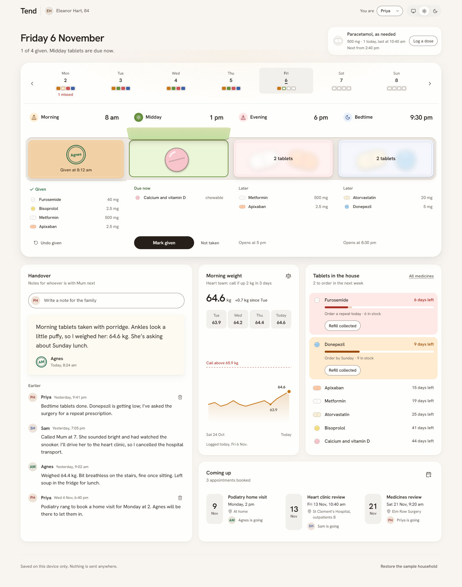
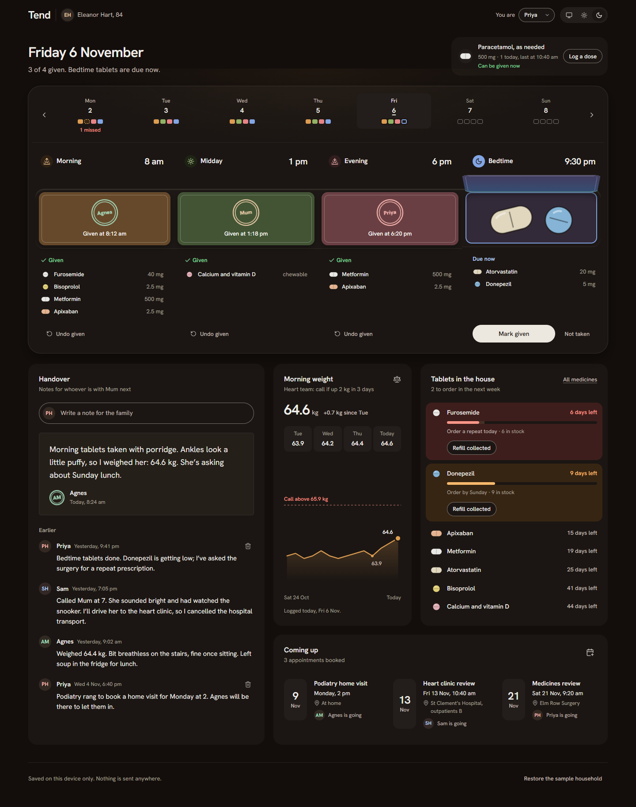
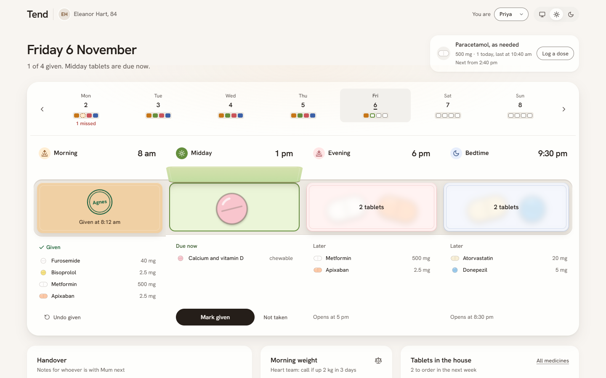
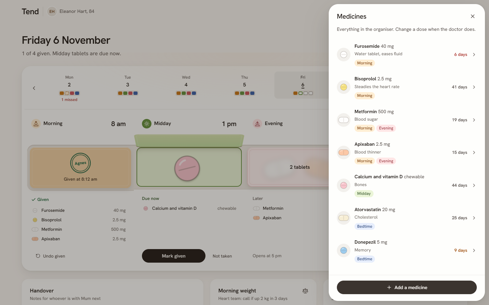
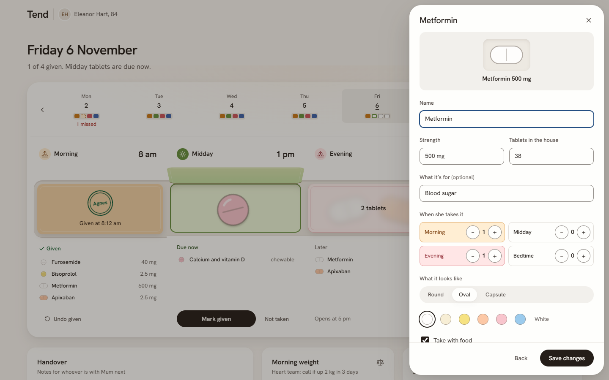
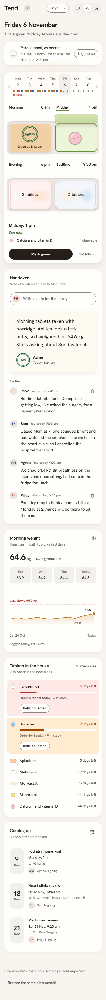
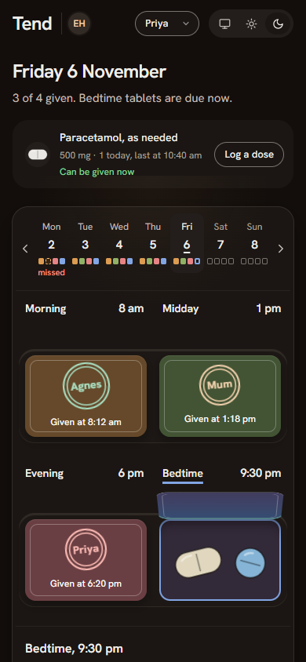

# Tend

A shared care organiser for families looking after an older parent. Today's medicines appear as a pill organiser
(one compartment per time of day), with tablets left, a weight trend, upcoming appointments and a handover note for
whoever visits next.

- **Who it's for:** adult children and carers who share a parent's care and need one place to see what was given,
  what is due and what needs re-ordering.
- **Status:** prototype. The Today screen is built and passes a 20-step end-to-end click-through test; light and dark
  themes; checked at desktop and phone widths with automated accessibility checks.
- **Privacy:** data stays in the browser on your device (localStorage). No accounts, no server. The sample household
  uses invented names.
- **Built with:** Vite, React 18, TypeScript; Python + Playwright for the click-through test.

## Screenshots

| Desktop, light | Desktop, dark |
|---|---|
|  |  |
|  |  |

| Medicine editor | Phone, light | Phone, dark |
|---|---|---|
|  |  |  |

## Run it

```bash
cd app
npm install
npm run dev          # http://localhost:5230/#/app
```

- `?at=13:10` pins the time of day (saving is off in that mode); `?theme=light|dark` forces a theme.
- Click-through test (dev server running): `pip install playwright && python tests/flows.py http://localhost:5230/`

## How it was designed

- `design-notes/direction.md`: the brief, the user, and the chosen design direction ("pill organiser").
- One type family (Hanken Grotesk); hierarchy from size, weight and colour only.
- The need was picked from five researched candidates; family caregiving coordination came from the Caregiver Action
  Network's Caregiver Tech Insights Survey 2026.

## Code map

- `app/src/model/`: types, sample household (`seed.ts`), store with undo and saving, derived dose status, supply and
  weight trend.
- `app/src/components/`: the organiser (compartments with lids), pill drawings, cards and editor sheets.
- `app/src/styles/`: design tokens for light and dark, base and app styles.
- `tests/flows.py`: end-to-end click-through of every feature.

## Licence

MIT. See [LICENSE](LICENSE).
